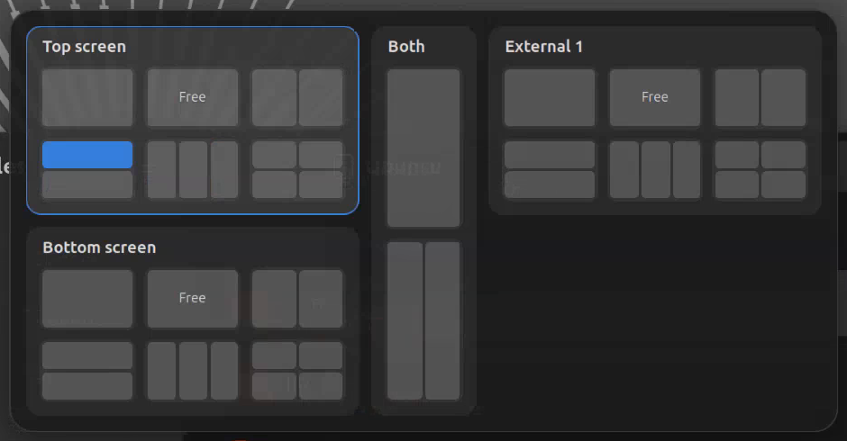
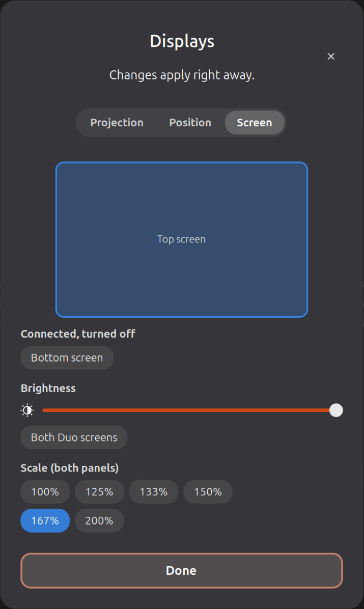
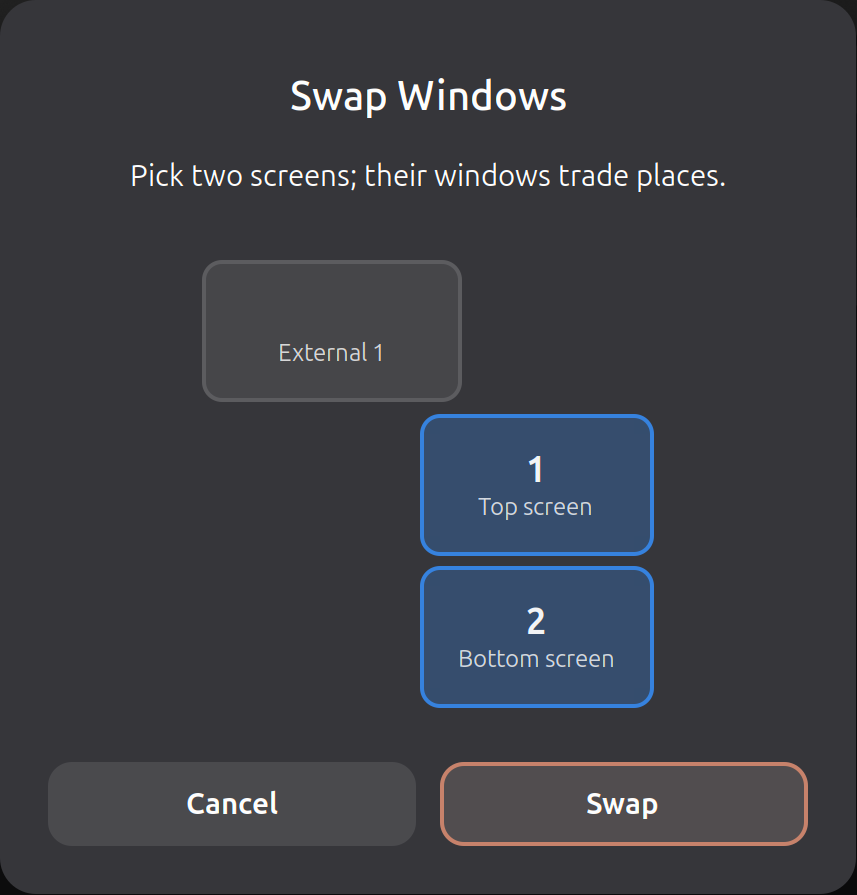

# Zenbook Duo GNOME Tools

A GNOME Shell extension for the ASUS Zenbook Duo (GNOME 50).

- **Snap while dragging.** Drag a window with the mouse or a finger and a popup next to the pointer offers layouts for the top screen, the bottom screen, both together and external screens: full, free, halves, stacked, thirds and quarters. Tiled windows resize together.
- **F8 / Shift+F8** swap the windows of two screens, or move the focused window to another screen.
- **F7** opens compact display controls: what to show where, mirroring, table mode, an external screen's position, rotation, scale and each panel's brightness.
- **Main display switch:** Shift+F7, or five fingers held still on a touch screen.
- **On-screen keyboard** only for finger taps, on the screen that doesn't hide the text field, and never while the keyboard is attached.
- **Pop-ups and warnings** for the [Zenbook Duo Linux](https://github.com/zakstam/zenbook-duo-linux) services (Fn lock, keyboard backlight, mic volume, keyboard battery).

The window snapping and display controls work on their own. The keys and pop-ups need the Zenbook Duo Linux services.

## Screenshots

Snap popup while dragging a window:



F7 display controls and the F8 swap dialog:

<p>
  
  
</p>

Main display switch:


## Install

Download `zenbook-duo-gnome-tools@zenbook-duo-linux.shell-extension.zip` from the [latest release](https://github.com/Antonskt/zenbook-duo-gnome-tools/releases/latest), then:

```bash
gnome-extensions install --force zenbook-duo-gnome-tools@zenbook-duo-linux.shell-extension.zip
```

Log out and back in, then turn it on in the Extensions app (or `gnome-extensions enable zenbook-duo-gnome-tools@zenbook-duo-linux`). Updates work the same way.

To build the zip yourself: `./pack.sh`.

## Tests

```bash
gjs -m tests/zones.test.js
```

## D-Bus

The Zenbook Duo Linux services call these methods on `org.gnome.Shell`, object `/org/gnome/Shell/Extensions/ZenbookDuoGnomeTools`, interface `org.gnome.Shell.Extensions.ZenbookDuoGnomeTools`: `ShowOsd`, `ShowMicVolume`, `ShowAlert`, `AppKeyPressed`, `ShiftF7Pressed` and `SetTopBrightness`. Their names and arguments stay stable. Without the extension, the services show notifications instead, or no pop-up for the mic volume.
